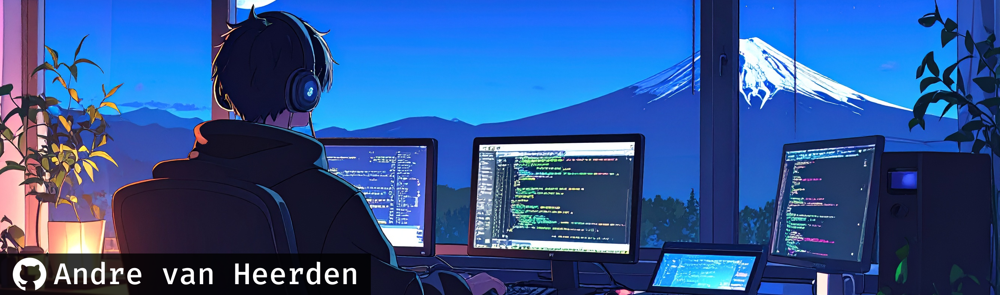
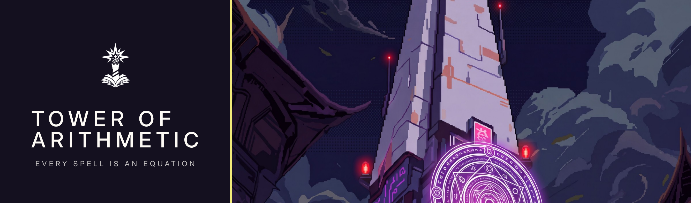
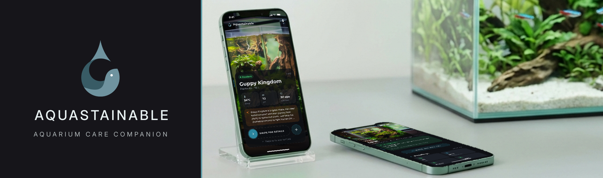
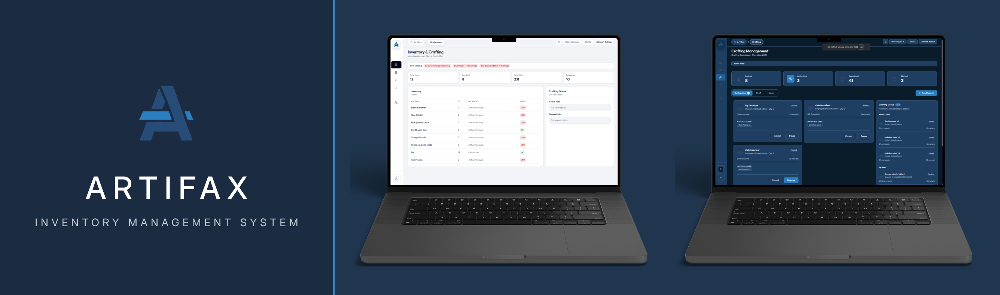
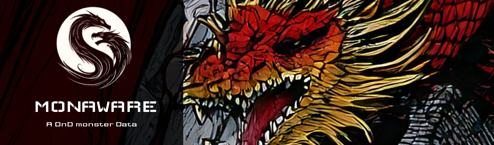
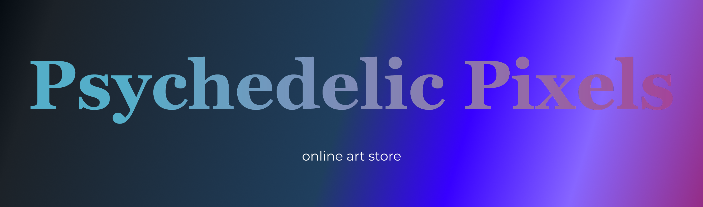
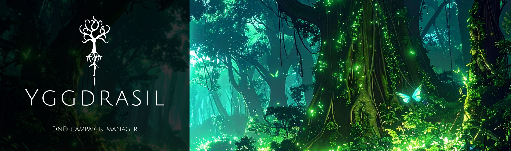

  
  
  
  
  
  
  
  
  
  
  

  

- - - -

 

<!-- Table of Contents -->

# Table of content

   
  
  
  
  
  
  

- - - -

 

# About me

Hi, I'm **Andre van Heerden** 👋, a UX/UI designer and front-end developer from Pretoria, South Africa, in my **third and final year** at Open Window, studying User Experience Design and Interactive Development.

I'm passionate about user experience and, above all, **UI design**, and I love bringing my designs to life as a front-end developer, building interfaces that look good and work just as well in the browser as they did in Figma.

I design by a principle I call **symbiotic design**: when a product genuinely makes life easier for the people using it, they keep coming back, and that's what makes it work for the business too. No dark patterns, no tricks.

- 🎓 **Studying:** BA in UX Design & Interactive Development, Open Window (final year)
- 💼 **Experience:** 6-month UX/AI generalist internship at Sand Dollar Design (2026)
- 🏆 **Achievement:** 2nd place, ABSA Hackathon 2026 (Gauteng universities)
- 🎯 **Dream job:** UX/UI Designer or Front-end Developer
- 🎮 **Outside of work:** gaming, anime, manga and dark-fantasy novels, which is where projects like a maths RPG come from. I also enjoy fly and deep-sea fishing and pen sketching.

- - - -

 

# Career Focus

<table>
  <tr>
    <td width="50%" valign="top">
      <h3>🎨 UX / UI Design</h3>
      My main focus. User research, wireframing, prototyping and polished, accessible interfaces in Figma, designed so both the user and the business win.
    </td>
    <td width="50%" valign="top">
      <h3>💻 Front-end Development</h3>
      Bringing my designs to life in React and React Native, so they work just as well in the browser and on mobile as they did in Figma.
    </td>
  </tr>
  <tr>
    <td width="50%" valign="top">
      <h3>🤖 AI-powered Features</h3>
      Building useful AI into products, like Socratic maths hints in Tower of Arithmetic and an aquarium-care assistant in Aquastainable.
    </td>
    <td width="50%" valign="top">
      <h3>🗄️ Back-end & Data</h3>
      Growing skills in Node.js, Express, .NET, Supabase and Firebase: APIs, authentication and databases that support the front-end.
    </td>
  </tr>
</table>

- - - -

 

# Tools & Tech Stack

## Design

## Front-end

## Mobile

## Back-end

## Databases

## AI, Tools & Deployment

- - - -

 

#  2026 (Third year) Portfolio Repos 

> ⭐ **My three main DV300 portfolio projects.**

## [Tower of Arithmetic](https://github.com/andrevanheerden-061104/Tower-of-Arithmetic) (Capstone)

Tower of Arithmetic is a turn-based fantasy RPG for Grades 1–11 where every action in the tower is powered by solving a maths problem. Learners climb a procedurally generated tower, casting spells, opening puzzle doors and fighting bosses, and every spell is an equation they type, say or draw.

It was built to tackle maths anxiety: there are no countdown timers, and a wrong answer gives a Socratic AI hint instead of a penalty. Questions are AI-generated and aligned to the South African CAPS curriculum, so runs never repeat, and three grade modes, a dyscalculia mode and read-aloud make it accessible to every learner. I designed the full UX in Figma and built and deployed the app myself.

#### **Technologies Used:**

- - - -

## [Aquastainable](https://github.com/andrevanheerden/Aquastainable)

Aquastainable is a mobile freshwater aquarium-care app that gives fishkeepers one place to manage their tanks, record water tests, and track their fish and plants. Users can swipe between their tanks on a dashboard, add fish from a species catalogue and get a compatibility check before adding them, covering tank size, stocking, water conditions, temperament and school size.

An aquarium-focused AI assistant helps when something goes wrong: users can send a sick fish or water problem to the assistant with their tank's context, and the app uses AI to write tank overviews and fill in missing species care information.

#### **Technologies Used:**

- - - -

## [Artifax](https://github.com/andrevanheerden-061104/Artifax) (Group project)

Artifax is a simple, highly reliable inventory management system for tracking internal warehouse operations. It manages inventory quantities across multiple warehouse locations, tracks base materials and the items crafted from them, schedules production timelines through a crafting queue, and uses role-based access control so admins and staff only see what they need.

The app runs as a desktop application with a React front-end and a scalable .NET back-end, with analytics dashboards and low-stock alerts to keep the warehouse running smoothly. It was built as a team, with automated testing on both the front-end and back-end.

#### **Technologies Used:**

- - - -

 

#  2025 (Second year) Portfolio Repos 
## [Monaware](https://github.com/andrevanheerden/formative-one-Monaware) (Semester 1)

Monaware is an app built using the D&D 5e SRD API, which provides comprehensive data on Dungeons & Dragons 5th Edition, including skills, equipment, spells, monsters, and more. Monaware focuses specifically on the monsters database, allowing users to view all stats and data for monsters or encounters. Users can access detailed information such as ability scores (Strength, Dexterity, Constitution, etc.), saving throws, skills, hit points, armor class, attack abilities, damage, and other important combat and lore-related stats.

In addition, Monaware allows users to compare the stats of two monsters or encounters side by side, making it easy to analyze strengths, weaknesses, and overall challenge levels for planning encounters. Since the D&D 5e SRD API does not include images for around 70% of monsters, the images used in Monaware were sourced from a community post on the D&D 5e SRD Discord. This ensures that users have a visually engaging experience while browsing monsters and encounters.

#### **Technologies Used:**

- - - -

## [Psychedelic Pixels](https://github.com/GabyNor05/Psychpix) (Semester 1)

Psychedelic Pixels is an e-commerce platform dedicated to showcasing and selling unconventional, surreal, and imaginative artwork. The website offers a curated selection of unique paintings, sculptures, and other artistic creations that fall outside the mainstream. Its primary purpose is to give art lovers, collectors, and curious minds a place to discover and purchase "weird art" works that are bold, thought-provoking, and unlike anything found in traditional galleries. By connecting eccentric artists with an audience that appreciates the bizarre and the extraordinary, Psychedelic Pixels celebrates creativity in its most unusual forms.

#### **Technologies Used:** 

- - - -

## [Yggdrasil](https://github.com/andrevanheerden/Yggdrasil) (Semester 2)

Yggdrasil is an all-in-one platform built for Dungeon Masters and Dungeons & Dragons players. Designed to streamline the campaign experience. It makes running and managing D&D adventures effortless for both newcomers and seasoned veterans.

The platform features a fully integrated, game-style inventory and creation system — empowering you to design your own classes, spells, weapons, items, monsters, characters, and more.

I created Yggdrasil out of a desire to simplify the D&D experience. Unlike existing tools such as D&D Beyond, which often hide key features behind paywalls and clutter the campaign management process, Yggdrasil focuses on accessibility, flexibility, and intuitive design — so you can spend less time organizing and more time adventuring.

#### **Technologies Used:** 

- - - -

 

# My Stats

  

  
  

  
  

- - - -

 

# Get in Touch

  
  
  
  

Student email: 241155@virtualwindow.co.za

